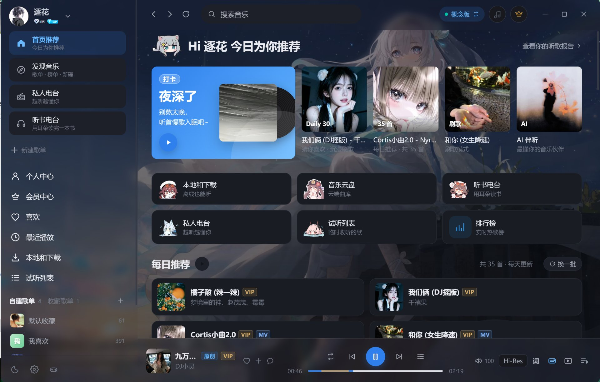

<div align="center">


# 萌萌音乐 · MengMeng Music

**把酷狗曲库装进你的桌面** —— 一款基于 Electron 的第三方酷狗音乐客户端

酷狗标准版 / 概念版双平台并行 · 逐字歌词 · 桌面 & 任务栏歌词 · 主题换肤 · MV 小窗 · 在线更新

[](https://moin.shrtxs.cn/changelog.php)
[](https://moin.shrtxs.cn/download.php)
[](https://moin.shrtxs.cn/development.php)
[](LICENSE)

**[🌐 项目主页](https://moin.shrtxs.cn/)** ·
**[⬇️ 下载安装包](https://moin.shrtxs.cn/download.php)** ·
[更新日志](https://moin.shrtxs.cn/changelog.php) ·
[开发部署](https://moin.shrtxs.cn/development.php) ·
[关于作者](https://moin.shrtxs.cn/about.php)

</div>

---

## 界面预览



> 首页：左侧资料库侧栏 + 顶部搜索栏 + 今日推荐卡片 + 每日推荐列表 + 底部播放条。
> 更多界面（播放栏、逐字歌词、桌面歌词、任务栏歌词、设置中心）见
> [项目主页 · 界面预览](https://moin.shrtxs.cn/#screens)。

---

## 项目简介

萌萌音乐是一款基于 [MakcRe/KuGouMusicApi](https://github.com/MakcRe/KuGouMusicApi) 的桌面音乐播放器，
支持 **酷狗音乐（标准版）** 与 **酷狗音乐概念版（lite）** 双模式切换，两套账号体系独立登录、独立播放。

界面由左侧资料库侧栏、顶部搜索栏、底部播放条、沉浸式全屏歌词页与独立桌面歌词悬浮窗组成；
支持浅色 / 深色主题、液态玻璃（可随时开关）、自定义图片 / 视频背景、个人中心与会员自动领取。

从 v1.2.0 起，客户端内置 **在线更新**：启动时静默检查新版本，弹窗提示、显示下载进度、
一键安装重启；配套官网同时充当更新服务器，作者在后台发布版本即可推送给所有用户。

* 当前版本：**v1.2.1**（2026-11-07）
* 运行平台：**Windows 10 / 11 · 64 位**
* 项目主页：**<https://moin.shrtxs.cn/>**
* 作者：**LHX · 宝藏水仙**

---

## 功能特性

### 账号与会员
- 扫码登录（二维码自动轮询）、手机验证码登录、账号密码登录，登录态自动续期与资料刷新
- 个人资料、VIP 状态、关注歌手、粉丝 / 关注数、听歌历史
- 双平台独立会话、独立设备指纹、退出登录
- 概念版会员中心：VIP 状态精确识别（`busi_vip`）、每日领取 1 天会员、升级畅听 VIP、领取日历
- **每天定时自动领取会员**（默认 09:00），启动时自动补领当天未领取的会员

### 发现与内容
- 首页：今日推荐、亿点点宝藏神曲、推荐歌单、排行榜、每日 30 首
- 发现页：精选歌单 / 分类歌单（标签筛选）/ 排行榜 / 歌手（热门·华语·欧美·日韩）/ 新碟 / 电台 / 刷歌 / AI 推荐 / 听歌识曲
- 歌单：详情、全部歌曲（分页加载）、相似歌单、标签、主题歌单、音效歌单
- 歌手：详情、热门 / 最新单曲、专辑、MV、关注 / 取关
- 专辑：详情、曲目列表、新碟上架
- MV：视频详情与在线播放
- 听书：每日 / 每周 / VIP / 榜单推荐、专辑详情与音频列表
- 私人 FM：个性化推荐电台，喜欢 / 不喜欢反馈

### 搜索
- 单曲 / **歌词** / 歌单 / 歌手 / 专辑 / MV 六个维度
- 关键词可命中「歌曲名」也可命中「歌词内容」，歌词结果高亮关键词并支持直接播放
- 搜索历史、热搜、搜索建议、推荐搜索 / 歌词优先模式切换

### 资料库
- 我喜欢的音乐、最近播放（本机记录 + 云端听歌排行）
- 试听列表、本地音乐（文件夹扫描、Range 流式播放）、已下载
- 我的歌单（新建 / 删除 / 添加歌曲 / 移除歌曲）、收藏歌单
- 音乐云盘（列表播放、刷新；上传 / 删除请使用手机客户端）
- 关注的歌手

### 播放器
- 播放 / 暂停、上一首 / 下一首、列表循环 / 单曲循环 / 随机
- 进度拖拽、音量（带数值显示）、静音、**播放倍速**（0.5x–2x）
- **播放列表居中弹窗**：搜索、定位、单曲移除、清空、全部加入试听
- 音质切换（标准 / 高品 / 无损 / Hi-Res），自动降级兜底
- 歌词：KRC 解码、逐行高亮滚动、点击行跳转、翻译行合并展示，歌词面板可收起
- 全屏沉浸页：唱片旋转、模糊封面背景、歌词字号可调
- **桌面歌词悬浮窗**：独立置顶窗口、锁定后鼠标穿透（Ctrl+Alt+L 解锁）
- **任务栏歌词**：叠在 Windows 任务栏上显示封面 + 歌词 + 控制按钮，只响应按钮、其余区域鼠标穿透
- **歌曲高潮**：自动拉取副歌区间，进度条绿色高亮，一键跳转
- 收藏、下载、评论、添加到歌单等快捷入口
- 系统媒体控制（Media Session）、后台不降频

### 外观与设置
- 浅色 / 深色 / 跟随系统，5 套主题色、4 种字体、歌词字号自定义
- **自定义背景**：支持图片与视频（自动循环播放），可调背景暗度
- **液态玻璃**：侧边栏、标题栏、播放条、设置卡片转为半透明毛玻璃 + 背景模糊
- 分组设置卡片：语言、主色调、搜索模式、导航方式、播放栏布局、原生窗口装饰器、
  音质选择、平衡音频响度、音频输出设备（setSinkId）、启动问候语、数据源、
  禁用 GPU 加速、高 DPI、关闭到托盘、开机自启动、网络模式、启动时最小化、
  阻止系统休眠、API 模式、RPC 地址、全局快捷键、网络代理、日志等

### 系统能力
- **托盘控制面板**：单击托盘图标弹出面板，显示封面 / 歌名 / 歌手 / 进度 / 当前歌词，
  提供上一首 · 播放暂停 · 下一首，以及检查更新、重启应用、显示 / 隐藏、退出程序
- **关闭窗口即退出**：默认点关闭真正结束进程；需要常驻可开启「关闭窗口时到托盘」
- **开机自启**：写入系统启动项（便携版写回便携 exe 路径），开机后静默进托盘，不弹窗
- **下载管理**：多任务进度回传、同名文件自动去重、附带 `.json` 元信息
- 无边框窗口：最小化 / 最大化 / 关闭、窗口圆角、原生标题栏可切换
- 歌曲列表显示 **原创 / VIP / MV** 徽标

### 在线更新（v1.2.0+）
- 启动时静默检查新版本，「设置 → 关于 → 检查更新」也可手动触发
- 发现新版本弹窗展示更新说明、体积与发布日期，支持「立即更新 / 下次再说 / 跳过此版本」
- 下载进度实时显示，完成后一键安装并重启（便携版走覆盖式更新）
- 双更新地址自动兜底，网络异常不会阻塞正常启动
- 更新服务由配套官网提供，作者在后台发布版本即可推送

---

## 技术栈

| 层 | 选型 |
| --- | --- |
| 前端框架 | Vue 3（`<script setup>` + Composition API） |
| 构建工具 | Vite 5 |
| 桌面框架 | Electron 33（无边框窗口 + 自定义标题栏） |
| 状态管理 | Pinia（app / user / player / library / ui / update） |
| 路由 | Vue Router 4（hash 模式，辅助窗口按 hash 区分角色） |
| UI 组件库 | Element Plus（配合自绘组件与图标系统） |
| 语言 | JavaScript |
| 数据接口 | [KuGouMusicApi](https://github.com/MakcRe/KuGouMusicApi)（本地双实例） |
| 打包 | electron-builder（NSIS 安装版 + 便携版） |
| 官网 / 更新服务 | PHP 8 + JSON 文件存储（无数据库，见下文「官网与更新后台」） |

---

## 快速开始

### 环境要求

- Windows 10 / 11（开发与打包均在 Windows 上验证）
- Node.js **v18 LTS 或更高**（自带 npm）
- Git 与一个顺手的编辑器

### 1. 准备数据接口

客户端的所有音乐数据都来自本地运行的 KuGouMusicApi，**默认与本项目放在同级目录**：

```text
你的目录/
├─ mm-music-site/        ← 本仓库（桌面客户端源码）
└─ KuGouMusicApi-1.6.3/  ← 接口服务（另行克隆 / 下载）
```

```bash
# 克隆接口服务（与本仓库同级）
git clone https://github.com/MakcRe/KuGouMusicApi.git KuGouMusicApi-1.6.3
cd KuGouMusicApi-1.6.3 && npm install
```

> 接口目录若放在别处，可在客户端「设置 → 数据接口」里修改，
> 或直接编辑 `userData/kg-config.json` 的 `apiDir`。
> 打包时 `package.json` 的 `build.extraResources` 会把该目录一起打进安装包，
> 因此打包前请确认路径与之一致。

### 2. 安装依赖并启动

```bash
# 安装客户端依赖
npm install

# 开发模式：一条命令同时拉起 Vite + Electron + 两个接口实例
npm run dev

# 生产模式预览
npm run build && npm start
```

主窗口内按 `F12`（或 `Ctrl+Shift+I`）打开 DevTools，主进程日志直接输出到终端。

### 3. 打包安装包

```bash
# 同时产出 NSIS 安装版 + 便携版（输出到 release/）
npm run dist

# 只出便携版
npm run dist:portable

# 重新生成图标与安装界面素材
npm run icon
npm run art
```

| 产物 | 说明 |
| --- | --- |
| `萌萌音乐-1.2.1-安装包.exe` | NSIS 中文安装程序：自选安装目录、桌面 / 开始菜单快捷方式、卸载保留用户数据 |
| `萌萌音乐-1.2.1-便携版.exe` | 免安装单文件，首次启动会解压到临时目录（约 60~100 秒） |

> 也可以直接在 **[项目主页下载](https://moin.shrtxs.cn/download.php)** 已打包好的版本。

---

## 双平台模式

| | 酷狗音乐（标准版） | 酷狗音乐概念版（lite） |
| --- | --- | --- |
| 接口实例 | `appid=1005 / clientver=20489` | `appid=3116 / clientver=11440` |
| 默认端口 | 32100 | 32101（被占用时自动顺延） |
| 登录态 | 独立 token（`kg-session-std`） | 独立 token（`kg-session-lite`） |
| 设备指纹 | 独立 GUID / DEV / MAC / WebGL | 独立 GUID / DEV / MAC / WebGL |

- 右上角胶囊按钮一键切换，切换后自动重新拉取该平台的推荐、歌单与登录态
- 两个平台的 token 不通用（酷狗官方限制），切换后需要各自登录
- 设备指纹首次生成后写入 `kg-config.json` 固定下来，保证 dfid / mid 稳定，提升取流成功率

---

## 在线更新是怎么走的

```text
客户端启动
   │  延时静默检查（不阻塞启动）
   ▼
GET {更新站}/api.php?action=check&version=1.2.1&channel=stable
   │
   ▼
后台返回：hasUpdate / latest(version, notes, url, portableUrl, size, force)
   │
   ├─ 无新版本 → 安静结束
   └─ 有新版本 → 弹窗（更新说明 / 体积 / 强制更新标记）
                    │ 用户点「立即更新」
                    ▼
              下载 exe（进度实时回传） → 校验 → 安装并重启
```

- 更新逻辑集中在 `electron/updater.cjs`，版本比较用语义化版本号
- 支持**跳过某个版本**（写入本地配置，该版本不再提示）与**强制更新**标记
- 便携版没有安装向导，采用「下载新 exe → 覆盖 → 重启」的方式
- 更新站地址可在设置中修改（`updateOrigin`），默认支持双地址自动重试
- 接口字段说明见官网的[更新接口文档](https://moin.shrtxs.cn/apidocs.php)

---

## 官网与更新后台

项目配套一个纯 PHP 的官网，**既是项目主页，也是更新服务器**，无需数据库，上传即可用：

- 前台：首页（LOGO + 介绍 + 展示图）、界面预览、功能卡片、更新日志、下载页、
  关于页（两位作者、项目仓库、免责声明）、开发部署文档、更新接口文档
- 后台：登录（限流 + CSRF）、官网内容编辑、界面预览图上传、作者信息与头像、
  功能卡片管理、版本发布与安装包上传、FAQ、下载统计、接口自检
- 特色：蓝黄渐变、流星背景、深浅主题滑动开关、中英文切换

部署后把客户端的更新地址指向该站点即可。详细步骤见
**[开发部署文档](https://moin.shrtxs.cn/development.php)**。

---

## 请求伪装说明

所有与酷狗的通信都由 **KuGouMusicApi** 在 Node 侧完成，客户端只与本机
`http://127.0.0.1:<port>` 通信：

1. **签名**：`signature` 由 `util/helper.js` 按 android / web / register 三种算法生成；
   `key` 由 `signKey / signParamsKey` 计算。
2. **请求头伪装**：`User-Agent: Android15-1070-11083-46-0-DiscoveryDRADProtocol-wifi`、
   `dfid / mid / clienttime / kg-rc / kg-thash / kg-rec / kg-rf` 等酷狗内部标识头。
3. **设备指纹**：GUID、DEV、MAC、WebGL Hash 由客户端生成并固定，经 Cookie 注入，
   服务端据此推导 `mid`，保证同一设备跨重启一致。
4. **风控指纹**：命中 SSA 验证时，模拟鼠标轨迹、滚动等行为数据生成 `edt / sid`。
5. **CDN 直链**：取流接口返回的 `url` 可能是字符串或数组（含 backupUrl），
   客户端做了完整解析与多音质、多 CDN 兜底。

---

## 会员状态与每日领取的实现说明

- **为什么 `/user/detail` 的 `vip_type` 恒为 0**：概念版会员走独立的 `busi_vip` 体系，
  真正的会员信息在 `/youth/union/vip` 返回的 `busi_vip[]` 中，字段包含
  `is_vip`、`vip_end_time`、`product_type`（svip / qvip）、`tvip_remain_second`。
- **领取接口**：`POST /youth/day/vip?receive_day=YYYY-MM-DD`（需登录、仅概念版），
  领取后可调用 `/youth/day/vip/upgrade` 升级为畅听 VIP。
- **自动领取**：渲染进程每分钟调用一次 `vip.tick()`，满足「已开启 + 已登录 +
  到达设定时间 + 当天未领取」时领取一次，结果写入本地存储防止重复请求；
  应用启动时会补领当天未领的会员。若需要应用关闭后仍能领取，可将接口服务常驻。

---

## 关于 20028「本次请求需要验证」

若取流返回 `errcode=20028`，说明请求被酷狗风控拦截，常见原因：未登录或登录态失效、
使用了机房 / 代理 IP、短时间大量请求同一接口。

客户端处理策略：

1. 先按用户设定音质请求完整音源；
2. 命中风控则调用 `/user/verify` 尝试获取 `auth`，再走 `/song/url/auth` 复核；
3. 仍失败时提示「该歌曲触发了安全验证，请登录酷狗账号后重试」；
4. 若歌曲为 VIP 专享，自动请求 `free_part=1` 返回 60 秒试听片段，并在播放条标注「试听」。

> 建议在家庭网络下登录账号使用；如需代理，请在设置页填写 HTTP 代理地址，客户端会透传给接口服务。

---

## 目录结构

```text
mm-music-site/                 ← 本仓库（萌萌音乐桌面客户端）
├─ electron/
│  ├─ main.cjs                 # 窗口、双平台接口托管、静态/媒体服务、下载、IPC
│  ├─ preload.cjs              # 受控的桌面能力桥接（contextBridge）
│  └─ updater.cjs              # 在线更新：检查 / 下载 / 安装 / 跳过版本
├─ src/
│  ├─ api/                     # 请求层、接口封装、数据归一化
│  ├─ stores/                  # app / user / player / library / ui / update
│  ├─ components/              # 布局、通用、播放器、发现、登录、更新弹窗
│  ├─ views/                   # 首页 / 发现 / 搜索 / 歌单 / 榜单 / 歌手 / 专辑 / 资料库 / 设置…
│  ├─ composables/             # useSongActions（播放、喜欢、下载、加入歌单）
│  ├─ router/                  # hash 路由（含桌面歌词 / 托盘 / 任务栏辅助窗口）
│  └─ utils/                   # 格式化、窗口角色判定等工具
├─ public/                     # 静态资源（图标、默认封面等）
├─ build/                      # 打包素材：icon.png / icon.ico / 安装界面 bmp
├─ scripts/
│  ├─ dev.mjs                  # 一条命令启动 Vite + Electron
│  ├─ make-icon.mjs            # 生成图标
│  └─ make-installer-art.mjs   # 生成安装界面素材
├─ docs/
│  ├─ logo.png                 # 软件 LOGO（README 顶部展示）
│  └─ screenshot.jpg           # 前台展示图（首页截图）
├─ index.html
├─ package.json                # 版本号、脚本、electron-builder 配置
├─ vite.config.mjs
└─ LICENSE
```

### 运行架构

```text
Electron 主进程
├─ 子进程 A：KuGouMusicApi（platform=''）     → 127.0.0.1:32100  标准版
├─ 子进程 B：KuGouMusicApi（--platform=lite） → 127.0.0.1:32101  概念版
├─ 静态服务：127.0.0.1:32190（固定端口，保证 localStorage 稳定）
├─ 媒体服务：/__media?p=base64 → 本地文件流（支持 Range 断点）
└─ 更新检查：HTTPS → 官网 api.php?action=check
        ▲ IPC（contextBridge）
        │
渲染进程（Vue 3 + Pinia）
```

- 两个接口实例以 `ELECTRON_RUN_AS_NODE=1` 复用 Electron 自带 Node 运行时，打包后无需额外安装 Node
- 端口被占用时自动顺延，并把实际端口通过 IPC 下发给渲染进程
- 桌面歌词 / 托盘 / 任务栏等辅助窗口不创建音频对象，并强制静音，避免重启后残留声音

---

## 常用快捷键

| 快捷键 | 功能 |
| --- | --- |
| `空格` | 播放 / 暂停 |
| `←` / `→` | 后退 / 前进 5 秒 |
| `↑` / `↓` | 音量 ±5% |
| `Esc` | 关闭全屏播放页 / 弹窗 |
| `Ctrl+Alt+L` | 解锁已锁定的桌面歌词 |
| `Ctrl+Shift+S` | 显示 / 隐藏主窗口 |
| `Ctrl+Q` | 退出程序 |

---

## 常见问题

**Q：软件收费吗？**
完全免费。本软件不提供、不存储任何音源文件，所有内容均来自公开接口，请支持正版音乐。

**Q：为什么有些歌无法播放？**
部分版权歌曲需要登录或会员权限才能取到播放地址，登录酷狗账号后成功率会明显提高；
触发风控（20028）时的处理策略见上文。

**Q：怎么更新到新版本？**
打开「设置 → 关于 → 检查更新」，或在[项目主页](https://moin.shrtxs.cn/download.php)
下载最新安装包覆盖安装，歌单与设置都会保留。

**Q：数据会上传吗？**
不会。登录态、歌单缓存、播放记录全部保存在本机，卸载前可在设置里打开数据目录备份。

---

## 免责声明

1. 本项目仅供学习使用，请尊重版权，请勿利用此项目从事商业行为及非法用途！
2. 使用本项目的过程中可能会产生版权数据。对于这些版权数据，本项目不拥有它们的所有权。为了避免侵权，使用者务必在 24 小时内清除使用本项目的过程中所产生的版权数据。
3. 由于使用本项目产生的包括由于本协议或由于使用或无法使用本项目而引起的任何性质的任何直接、间接、特殊、偶然或结果性损害（包括但不限于因商誉损失、停工、计算机故障或故障引起的损害赔偿，或任何及所有其他商业损害或损失）由使用者负责。
4. 禁止在违反当地法律法规的情况下使用本项目。对于使用者在明知或不知当地法律法规不允许的情况下使用本项目所造成的任何违法违规行为由使用者承担，本项目不承担由此造成的任何直接、间接、特殊、偶然或结果性责任。
5. 音乐平台不易，请尊重版权，支持正版。
6. 本项目仅用于对技术可行性的探索及研究，不接受任何商业（包括但不限于广告等）合作及捐赠。
7. 如果官方音乐平台觉得本项目不妥，可联系本项目更改或移除。

> 代码层面的许可见 [LICENSE](LICENSE)；音乐、歌词、封面等内容的版权归原作者所有，
> 使用本项目即表示你已阅读并同意上述全部条款。

---

## 致谢

- [MakcRe/KuGouMusicApi](https://github.com/MakcRe/KuGouMusicApi) —— 酷狗音乐接口服务，本项目的数据基础
- [Vue](https://vuejs.org/) / [Vite](https://vitejs.dev/) / [Electron](https://www.electronjs.org/)
- [Pinia](https://pinia.vuejs.org/) / [Vue Router](https://router.vuejs.org/) / [Element Plus](https://element-plus.org/)
- [electron-builder](https://www.electron.build/) / [Jimp](https://github.com/jimp-dev/jimp)

## 作者

**LHX · 宝藏水仙** —— 一个管客户端逻辑，一个管视觉与手感。

- 项目主页：<https://moin.shrtxs.cn/>
- 关于作者：<https://moin.shrtxs.cn/about.php>
- 问题反馈：欢迎在本仓库提交 Issue
