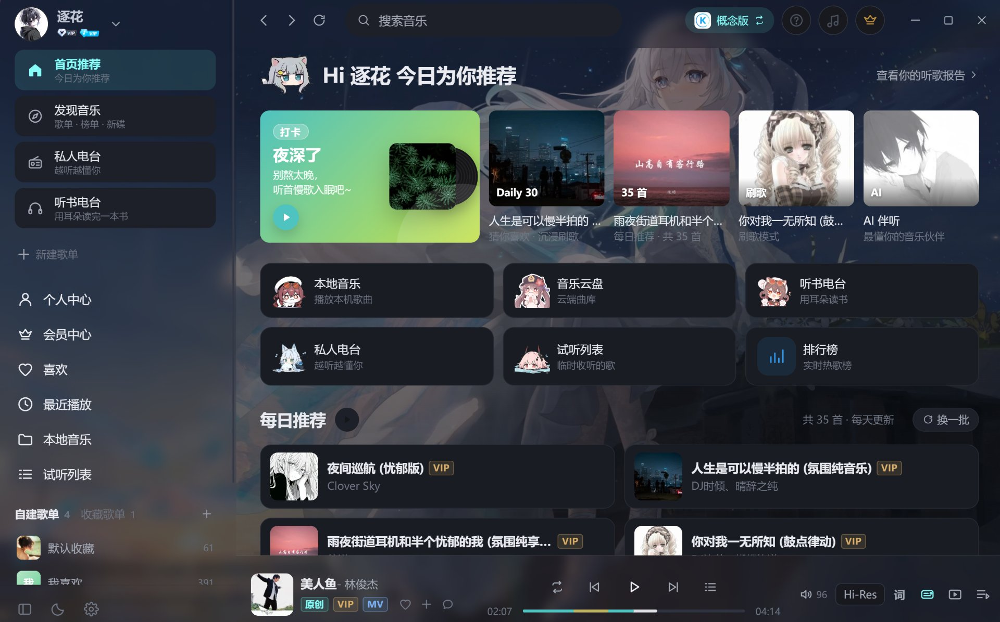

<p align="center">
  
</p>

<h1 align="center">萌萌音乐 · MengMeng Music</h1>

<p align="center">
  
  
  
  
</p>

<p align="center">
  <b>一款基于酷狗音乐接口的桌面音乐播放器，支持「标准版 / 概念版」双模式切换。</b>
</p>

<p align="center">
  🔗 <b>项目主页 / 下载</b>：<a href="https://moin.shrtxs.cn/">https://moin.shrtxs.cn/</a>
</p>

---

## 📸 软件展示

> 下图为本程序「首页推荐」界面（前台展示图），深色主题、青绿色强调色，左侧资料库侧栏 + 顶部搜索栏 + 底部播放条。

<p align="center">
  
</p>

界面要点：

- **左侧导航栏**：用户头像与昵称、VIP 标识、首页推荐 / 发现音乐 / 私人电台 / 听书电台 / 个人中心 / 会员中心 / 喜欢 / 最近播放 / 本地音乐 / 试听列表，底部含自建歌单与深色模式、设置入口。
- **顶部栏**：播放控制、搜索框、概念版切换胶囊、听书 / 音乐 / 会员圆形入口、窗口控制按钮。
- **中部主区**：今日推荐问候、打卡卡片、推荐卡片、功能入口、每日推荐歌单。
- **底部播放条**：封面、歌名 / 歌手、进度 / 音量、Hi-Res 标识、歌词、倍速等。

---

## 📖 项目简介

**萌萌音乐** 是一款使用 Electron + Vue 3 打造的 Windows 桌面音乐客户端。它在本地托管酷狗音乐的接口服务，所有的歌曲搜索、播放、会员能力都通过本机 `127.0.0.1` 接口完成，客户端本身不存储、不分发音源文件。

主要特点：

- **双平台模式**：标准版（酷狗音乐）与概念版（lite）一键切换，两套账号体系独立登录、独立播放、独立会员状态。
- **完整的听歌体验**：搜索（含歌词搜索）、每日推荐、排行榜、歌单、歌手、专辑、MV、听书电台、私人 FM。
- **会员与自动领取**：精确识别会员类型，支持每日自动领取会员。
- **个性化外观**：浅色 / 深色主题、自定义图片 / 视频背景、液态玻璃、5 套主题色、桌面歌词悬浮窗、任务栏歌词。
- **系统级能力**：托盘控制面板、开机自启、关闭到托盘、全局快捷键、系统媒体控制。

> 提示：本软件需要配合接口服务（[MakcRe/KuGouMusicApi](https://github.com/MakcRe/KuGouMusicApi)）一起运行，安装包已内置该能力，开箱即用。

---

## ✨ 核心特性

### 账号与登录
- 扫码登录（二维码自动轮询）、手机验证码登录、**账号密码登录**、登录态自动续期与资料刷新。
- 个人资料、VIP 状态、关注歌手、粉丝 / 关注数、听歌历史。
- 双平台独立会话、退出登录。

### 会员中心（概念版）
- VIP 状态精确识别：读取 `/youth/union/vip` 的 `busi_vip`，区分超级 VIP / 畅听 VIP / 概念版 VIP。
- 每日领取 1 天会员、升级畅听 VIP、当月领取日历与领取记录。
- **每天定时自动领取**：可设置时间（默认 09:00），应用运行期间到点自动领取；启动时会补领当天未领取的会员，可选领取后自动升级。
- 侧边栏与设置页实时显示会员有效期与剩余时长。

### 发现与内容
- 首页：今日推荐、亿点点宝藏神曲、推荐歌单、排行榜、每日 30 首。
- 发现页：精选歌单 / 分类歌单（标签筛选）/ 排行榜 / 歌手（热门·华语·欧美·日韩）/ 新碟 / 电台 / 刷歌 / AI 推荐 / 听歌识曲。
- 排行榜：全部榜单、榜单详情、榜单歌曲。
- 歌单：详情、全部歌曲（分页加载）、相似歌单、标签、主题歌单、音效歌单。
- 歌手：详情、热门 / 最新单曲、专辑、MV、关注 / 取关。
- 专辑：详情、曲目列表、新碟上架。
- MV：视频详情与在线播放。
- 听书：每日 / 每周 / VIP / 榜单推荐、专辑详情与音频列表。
- 私人 FM：个性化推荐电台，喜欢 / 不喜欢反馈。

### 搜索
- 单曲 / **歌词** / 歌单 / 歌手 / 专辑 / MV 六个维度。
- 关键词可命中「歌曲名」也可命中「歌词内容」，歌词结果高亮关键词并支持直接播放。
- 搜索历史、热搜、搜索建议、推荐搜索 / 歌词优先模式切换。

### 资料库
- 我喜欢的音乐、最近播放（本机记录 + 云端听歌排行）。
- 试听列表、本地音乐（文件夹扫描、Range 流式播放）、已下载。
- 我的歌单（新建 / 删除 / 添加歌曲 / 移除歌曲）、收藏歌单。
- 音乐云盘（列表播放、刷新；上传 / 删除请使用手机客户端）。
- 关注的歌手。

### 播放器
- 播放 / 暂停、上一首 / 下一首、列表循环 / 单曲循环 / 随机。
- 进度拖拽、音量（带数值显示）、静音、**播放倍速**（0.5x–2x）。
- **播放列表居中弹窗**：搜索、定位、单曲移除、清空、全部加入试听。
- 音质切换（标准 / 高品 / 无损 / Hi-Res / 蝰蛇音质），自动降级兜底；无对应会员时给出明确提示。
- 歌词：KRC 解码、逐行高亮滚动、点击行跳转、翻译行合并展示，**歌词面板可收起**。
- 全屏沉浸页：唱片旋转、模糊封面背景、歌词字号可调。
- **桌面歌词悬浮窗**：独立置顶窗口、锁定后鼠标穿透（Ctrl+Alt+L 解锁）。
- 收藏、下载、评论、添加到歌单等快捷入口（播放条 + 列表菜单）。
- 系统媒体控制（Media Session）、后台不降频。

### 外观
- **自定义背景**：支持图片与视频（自动循环播放），可调背景暗度。
- **液态玻璃**：侧边栏、标题栏、播放条、设置卡片转为半透明毛玻璃 + 背景模糊。
- **深色模式**：全量 CSS 变量化的暗色主题，含 Element Plus 组件适配。
- 5 套主题色、4 种字体、歌词字号自定义。

### 交互与系统能力
- 歌曲「更多」菜单：下一首播放、加入队列、添加到歌单、下载、查看专辑、复制歌名。
- 评论：热门 / 最新、发评论、分页加载。
- 下载管理：多任务进度回传、同名文件自动去重、附带 `.json` 元信息。
- **托盘控制面板**：单击托盘图标弹出深色面板，显示封面 / 歌名 / 歌手 / 进度 / 当前歌词，提供上一首 · 播放暂停 · 下一首，以及检查更新、重启应用、显示 / 隐藏、退出程序。
- **任务栏歌词**：默认常开，直接叠在 Windows 任务栏上，显示封面 + 歌词 + 上一首 / 播放 / 下一首；只响应按钮，其余区域鼠标穿透；支持「压在任务栏上 / 屏幕最底部」位置切换。
- **关闭窗口即退出**：默认点关闭真正结束进程；需要常驻可在「设置 → 系统 → 关闭窗口时到托盘」开启。
- **开机自启**：写入系统启动项（便携版写回便携 exe 路径），开机后静默进托盘，不弹窗。
- 歌曲高潮自动拉取副歌区间，进度条绿色高亮，一键跳转。
- MV 观看：带 MvHash 的歌曲在播放条 / 全屏播放页都有 MV 入口，弹窗内直接播放。
- VIP 取流兜底、页面滚动统一、一键返回顶部、顶部刷新按钮重新拉取当前页数据。
- 无边框窗口：最小化 / 最大化 / 关闭、窗口圆角、最大化状态自适应、原生标题栏可切换。

---

## 🧱 技术栈

| 层 | 选型 |
| --- | --- |
| 前端框架 | Vue 3（`<script setup>` + Composition API） |
| 构建工具 | Vite 5 |
| 桌面框架 | Electron 33（无边框窗口 + 自定义标题栏） |
| 语言 | JavaScript |
| 状态管理 | Pinia（app / user / player / library / ui） |
| UI 组件库 | Element Plus（配合自绘组件与图标系统） |
| 接口服务 | 本机托管的 KuGouMusicApi（Node 子进程） |

---

## ⚡ 双平台模式

| | 酷狗音乐（标准版） | 酷狗音乐概念版（lite） |
| --- | --- | --- |
| 接口实例 | `appid=1005 / clientver=20489` | `appid=3116 / clientver=11440` |
| 默认端口 | 32100 | 32101（被占用时自动顺延） |
| 登录态 | 独立 token（`kg-session-std`） | 独立 token（`kg-session-lite`） |
| 设备指纹 | 独立 GUID / DEV / MAC / WebGL | 独立 GUID / DEV / MAC / WebGL |

- 右上角胶囊按钮一键切换，切换后自动重新拉取该平台的推荐、歌单与登录态。
- 两个平台的 token 不通用（酷狗官方限制）；切换后需要各自登录。
- 设备指纹首次生成后写入配置固定下来，保证 `dfid / mid` 稳定，提升取流成功率。

---

## 🚀 快速开始

### 方式一：下载安装包（推荐）
前往 **项目主页 [https://moin.shrtxs.cn/](https://moin.shrtxs.cn/)** 下载最新版安装包：

| 文件 | 说明 |
| --- | --- |
| `萌萌音乐-1.2.5-安装包.exe` | NSIS 中文安装程序（自选安装目录、桌面 / 开始菜单快捷方式、卸载保留用户数据） |
| `萌萌音乐-1.2.5-便携版.exe` | 免安装，首次启动会解压到临时目录（约 60~100 秒） |

### 方式二：从源码构建

```bash
# 1. 安装接口服务依赖（KuGouMusicApi 与本项目同级）
cd ../KuGouMusicApi-1.6.3 && npm install

# 2. 安装客户端依赖
cd ../kugou-music && npm install

# 3. 开发模式（自动启动 Vite + Electron，并托管两个平台接口实例）
npm run dev

# 4. 生产模式预览
npm run build && npm start

# 5. 打包 Windows 安装包（NSIS 安装版 + 便携版，输出到 release/）
npm run dist

# 只出便携版
npm run dist:portable
```

> 首次启动会校验 `../KuGouMusicApi-1.6.3` 目录；如放置在别处，可在
> 设置页或 `userData/kg-config.json` 的 `apiDir` 中指定。

---

## 📂 目录结构与运行架构

```
kugou-music/
├─ electron/
│  ├─ main.cjs          # 窗口、双平台接口托管、静态/媒体服务、下载、IPC
│  └─ preload.cjs       # 受控的桌面能力桥接
├─ scripts/
│  ├─ dev.mjs           # 一条命令启动 Vite + Electron
│  ├─ make-installer-art.mjs   # 生成安装器位图（调用 Python）
│  └─ make-installer-art.py    # 带品牌 LOGO 的自下而上 BMP 生成（Pillow）
├─ src/
│  ├─ api/              # 请求层、接口封装、数据归一化
│  ├─ stores/           # app / user / player / library / ui
│  ├─ components/       # 布局、通用、播放器、发现、登录组件
│  ├─ views/            # 页面（首页/发现/搜索/歌单/榜单/歌手/专辑/资料库…）
│  ├─ composables/      # useSongActions（播放、喜欢、下载、加入歌单）
│  └─ utils/            # 格式化工具、品牌标识
└─ vite.config.mjs
```

### 运行架构

```
Electron 主进程
├─ 子进程 A：KuGouMusicApi（platform=''） → 127.0.0.1:32100  标准版
├─ 子进程 B：KuGouMusicApi（--platform=lite）→ 127.0.0.1:32101  概念版
├─ 静态服务：127.0.0.1:32190（固定端口，保证 localStorage 稳定）
└─ 媒体服务：/__media?p=base64 → 本地文件流（支持 Range 断点）
        ▲ IPC（contextBridge）
        │
渲染进程（Vue3 + Pinia）
```

- 两个接口实例以 `ELECTRON_RUN_AS_NODE=1` 复用 Electron 自带 Node 运行时，打包后无需额外安装 Node。
- 端口被占用时自动顺延，并把实际端口通过 IPC 下发给渲染进程。

---

## ⌨️ 常用快捷键

| 快捷键 | 功能 |
| --- | --- |
| `空格` | 播放 / 暂停 |
| `←` / `→` | 后退 / 前进 5 秒 |
| `↑` / `↓` | 音量 ±5% |
| `Esc` | 关闭全屏播放页 / 弹窗 |
| `Ctrl+Alt+L` | 锁定 / 解锁桌面歌词 |
| `Ctrl+Shift+S` | 显示 / 隐藏主窗口 |
| `Ctrl+Q` | 退出程序 |

---

## ⚠️ 关于风控（20028「本次请求需要验证」）

若取流返回 `errcode=20028`，说明请求被酷狗风控拦截，常见原因：

- 未登录或登录态失效；
- 使用了机房 IP / 代理 IP（家庭宽带基本不会触发）；
- 短时间大量请求同一接口。

客户端处理策略：先按用户设定音质请求完整音源；命中风控则尝试获取 `auth` 复核；仍失败时提示「该歌曲触发了安全验证，请登录酷狗账号后重试」；若为 VIP 专享则回退 60 秒试听片段并标注「试听」。

> 建议：在家庭网络下登录账号使用；如需代理，请在设置页填写 HTTP 代理地址，客户端会透传给接口服务。

---

## 📌 免责声明

> **本项目仅供个人学习与技术研究使用，不得用于任何商业用途。**

1. 本软件所有音乐、封面、歌词等内容版权均归 **酷狗音乐及相应版权方** 所有，本程序不存储、不分发任何音源文件，仅在本机转发接口数据。
2. 使用本项目产生的任何版权数据（包括缓存、下载、歌词、封面等），请于 **24 小时内自行清除**，喜欢请支持正版。
3. 本项目与酷狗音乐官方无任何隶属或合作关系，软件名称、界面风格若与官方产品存在相似，纯属技术实现之巧合。
4. 因使用本项目导致的账号封禁、数据丢失、设备损坏等任何后果，由使用者自行承担，**开发者不承担任何责任**。
5. 请在下载后 **24 小时** 内删除本项目；若您继续使用，即视为已阅读、理解并同意上述全部条款。

---

## 📄 许可证

本项目采用 **萌萌音乐学习使用许可协议（MML-1.0）**：

- ✅ 允许：个人学习、阅读源码、技术研究、非公开的修改实践；
- ❌ 禁止：任何商业用途（销售、内置广告、付费会员、捆绑分发等）、以本项目名义接受商业合作与捐赠、删除版权声明；
- 使用本项目即视为同意 [LICENSE](./LICENSE) 的全部条款，不同意请立即停止使用并删除本项目。

---

<p align="center">
  Made with ♪ by <b>LHX / 宝藏水仙</b> · 项目主页 <a href="https://moin.shrtxs.cn/">moin.shrtxs.cn</a>
</p>
